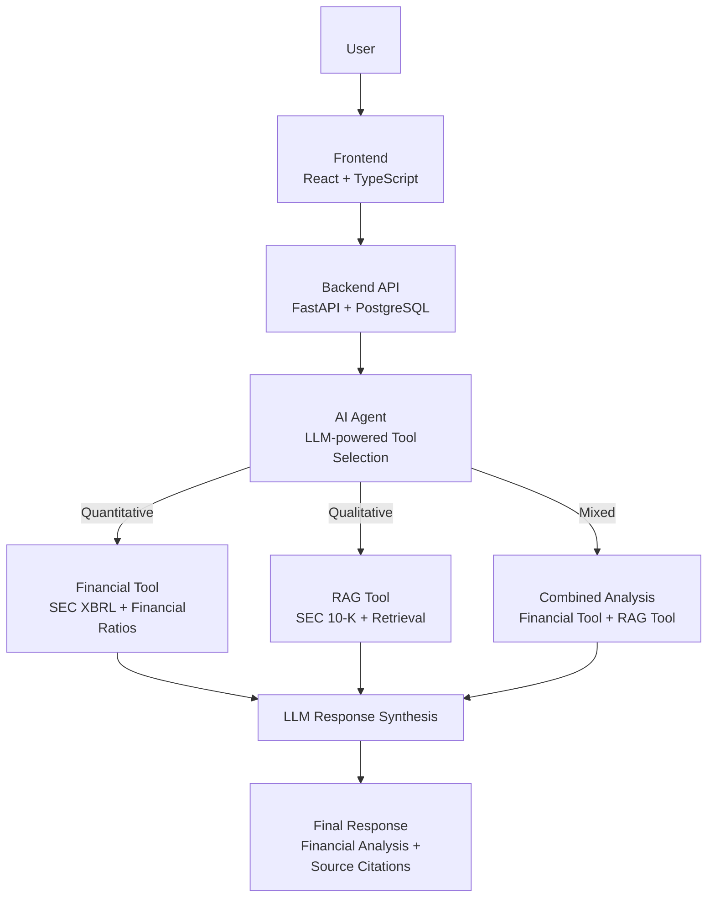

# Financial-analysis-agent

## 📖 Project Overview
<dl>
<ul>

Financial Analysis Agent is an evolving agentic AI
system designed to assist in assessing a company's
financial health by leveraging two main sources of
financial information:

</ul>
</dl>

<dl>
<ul>

- <strong> Financial statements: </strong> Balance sheets, income
  statements, and cash statements.
  
####

- <strong> Regulatory financial filing: </strong> Management's 
  Discussion and Analysis (MD&A), providing insights into the 
  company's financial performance, business 
  developments, and risk factors.
  </ul>
</dl>

<dl>
<ul>

The first version (V1) focuses on two complementary
capabilities:

</ul>
</dl>

<dl>
<ul>

- <strong>Financial ratio analysis:</strong> Calculating and interpreting key financial 
  ratios to assess a company's liquidity, profitability, and solvency.

####

- <strong>Intelligent financial document analysis:</strong> Leveraging management 
  reports to contextualize financial ratios, explain financial 
  performance, and identify potential business and financial risks.

</ul>
</dl>

<dl>
<ul>

These capabilities can operate independently or 
together, depending on the user's request.
The AI agent dynamically selects
the appropriate tool or combination of tools to
provide relevant, evidence-based financial insights.

</ul>
</dl>

## 🎯 Objective

<dl>
<ul>

Companies generate large volumes of financial
data and regulatory filings, making financial
analysis complex and time-consuming for
financial analysts.

This project combines financial analysis techniques
with artificial intelligence to assist financial
analysts by automating selected analytical tasks,
reducing the time required for financial analysis,
facilitating the interpretation of financial
performance, and supporting informed
decision-making while preserving human oversight
and professional judgment.

</ul>
</dl>

## 🗺️ Development Roadmap

<dl>
<ul>

The project is currently in its early development stage. The following roadmap outlines completed milestones and planned V1 development activities.

### 1. Project Initialization

- [x] ~~Initialize the Python development environment.~~
- [x] ~~Establish the initial project structure.~~
- [x] ~~Configure Git and GitHub version control.~~

### 2. SEC Financial Data Exploration

- [x] ~~Retrieve Apple financial data from SEC EDGAR (XBRL).~~
- [ ] Complete exploratory analysis of financial data.
- [ ] Implement data cleaning and preprocessing.
- [ ] Develop the SEC data ingestion pipeline.

### 3. Financial Analysis Tool

- [ ] Define and validate the financial ratio catalog.
- [ ] Implement financial ratio calculations.
- [ ] Support historical financial comparisons.
- [ ] Develop the Financial Tool interface.

### 4. RAG Tool

- [ ] Extract and preprocess SEC 10-K filing content.
- [ ] Implement document chunking and embeddings.
- [ ] Integrate ChromaDB for vector storage and retrieval.
- [ ] Develop the RAG Tool.

### 5. AI Agent Integration

- [ ] Configure the local Qwen3 model with Ollama.
- [ ] Implement agent orchestration with LangGraph.
- [ ] Integrate the Financial Tool and RAG Tool.
- [ ] Support combined quantitative and qualitative analysis.

### 6. Backend & Frontend

- [ ] Develop the FastAPI REST API.
- [ ] Integrate PostgreSQL for application data persistence.
- [ ] Implement authentication, authorization, and security controls.
- [ ] Develop the React + TypeScript user interface.

### 7. Testing & Evaluation

- [ ] Validate financial calculations and source citations.
- [ ] Evaluate RAG retrieval quality and response faithfulness.
- [ ] Test agent tool selection and response reliability.
- [ ] Evaluate security safeguards and sensitive data protection.

</ul>
</dl>


## ⚙️ Features
### &emsp; &emsp; Version 1 — Planned Features
### &emsp; &emsp;  Financial Analysis Tool
<dl>
<ul><ul><ul>

Calculate and interpret key liquidity,
profitability, and solvency ratios
using structured financial data,
with basic historical comparisons.

</ul></ul></ul>
</dl>

### &emsp; &emsp;  Intelligent Financial Document Analysis

<dl>
<ul><ul><ul>

Retrieve and analyze relevant
information from  SEC, 10-K filings,
including management discussions,
risk factors, cybersecurity disclosures, and
financial statement notes.

</ul></ul></ul>
</dl>

### &emsp; &emsp;  Intelligent Tool Selection

<dl>
<ul><ul><ul>

Dynamically select the Financial Tool
RAG Tool, or both based on the user's
question.

</ul></ul></ul>
</dl>


### &emsp; &emsp;  Evidence-Based Financial Responses

<dl>
<ul><ul><ul>

Generate contextualized financial explanations
supported by verifiable calculations, reporting
periods, and references to SEC filings.

</ul></ul></ul>
</dl>


### &emsp; &emsp; Future Enhancements

<dl>
<ul><ul>

- <strong> Multi-Company Analysis: </strong> Compare financial performance across companies.

####

- <strong> Advanced Financial Analysis: </strong> Expand the range of financial metrics and analytical methods.

####

- <strong> Financial Visualization: </strong> Provide charts and interactive financial dashboards.

####

- <strong> Multi-Source Integration: </strong> Support additional financial information providers and regulatory sources.

####

- <strong> Automated Report Generation: </strong> Generate structured financial analysis reports for review and export.

</ul></ul>
</dl>


## 🛠️ Technologies
### &emsp; &emsp; ✅ Currently Used

### &emsp; &emsp; &emsp;  Development & Testing

<dl>
<ul><ul><ul>

- <strong>Python 3.11</strong> — Core programming language

- <strong>uv</strong> — Python environment and dependency management

- <strong>Jupyter Notebook</strong> — Financial data exploration

- <strong>Git / GitHub</strong> — Version control and source code management

</ul></ul></ul>
</dl>

### &emsp; &emsp; 📋 Planned Technologies
### &emsp; &emsp; &emsp;   Backend

<dl>
<ul><ul><ul>

- <strong>FastAPI</strong> — REST API development
- <strong>Pydantic</strong> — Data validation and serialization
- <strong>PostgreSQL</strong> — Relational database management
- <strong>SQLAlchemy</strong> — ORM and database interaction
- <strong>Alembic</strong> — Database schema migrations
- <strong>psycopg</strong> — PostgreSQL database driver
- <strong>Pydantic Settings</strong> — Application configuration and secrets management
- <strong>FastAPI Security / OAuth2</strong> — Authentication and security dependencies
- <strong>RBAC (Role-Based Access Control)</strong> — Role-based authorization using FastAPI, SQLAlchemy, and PostgreSQL
- <strong>PyJWT / pwdlib</strong> — Token handling and secure password hashing
- <strong>CORS Middleware / Rate Limiting</strong> — Cross-origin access control and API request protection

</ul></ul></ul>
</dl>

#### &emsp; &emsp; &emsp;&emsp;🧠 Agentic AI & Retrieval-Augmented Generation (RAG)
<dl>
<ul><ul><ul>

- <strong>LangChain</strong> — LLM, tool, and retrieval integrations
- <strong>LangGraph</strong> — Agent orchestration and workflow management
- <strong>Qwen3</strong> — Open-weight Large Language Model
- <strong>Ollama</strong> — Local LLM inference
- <strong>Qwen3-Embedding</strong> — Financial document embeddings
- <strong>ChromaDB</strong> — Vector storage and semantic retrieval
- <strong>Microsoft Presidio</strong> — Sensitive data detection and anonymization
- <strong>Custom Agent Guardrails</strong> — Tool access restrictions, prompt injection risk mitigation, and input/output validation
- <strong>Promptfoo</strong> — Adversarial testing and LLM security evaluation
</ul></ul></ul>
</dl>

#### &emsp; &emsp; &emsp;&emsp;📊 Financial Data & Analysis
<dl>
<ul><ul><ul>

- <strong>SEC EDGAR API / XBRL</strong> — Financial data retrieval
- <strong>pandas / NumPy</strong> — Financial data processing and numerical computations
- <strong>Beautiful Soup</strong> — SEC filing content extraction
- <strong>Custom Financial Ratio Catalog</strong> — Validated formulas and interpretation guidelines

</ul></ul></ul>
</dl>

</ul></ul></ul>
</dl>

#### &emsp; &emsp; &emsp;&emsp;💻 Frontend
<dl>
<ul><ul><ul>

- <strong>React</strong> — User interface development
- <strong>TypeScript</strong> — Type-safe frontend development
- <strong>Vite</strong> — Frontend development and build tooling
- <strong>HTML</strong> — Application structure and semantic markup
- <strong>CSS</strong> — Interface styling and responsive design

</ul></ul></ul>
</dl>

### &emsp; &emsp; &emsp;  Evaluation & Reliability
<dl>
<ul><ul><ul>

- <strong>pytest</strong> — Automated testing of financial calculations and application logic
- <strong>Ragas</strong> — RAG faithfulness and retrieval quality evaluation
- <strong>DeepEval</strong> — LLM and agent behavior evaluation
- <strong>LangSmith</strong> — Agent execution tracing and debugging

</ul></ul></ul>
</dl>


## 🏗️ System Architecture & Workflow

<dl>
<ul>

The following diagram illustrates the proposed architecture and high-level workflow of the Financial Analysis Agent.

Based on the user's question, the AI agent dynamically selects the Financial Tool, the RAG Tool, or both. The retrieved evidence and computed financial results are then used to generate a source-grounded financial response.



<strong>Note:</strong> This diagram represents the planned V1 architecture.

</ul>
</dl>


## 🚧 Project Status

Version 1 — In progress: Creating the public home page.

## 📁 Project structure

```text
Financial-analysis-agent/
│
├── src/                                    → Application source code [Existing]
│   └── financial_analysis_agent/           → Main Python package [Existing]
│       ├── __init__.py                     → Package initialization [Existing]
│       │
│       ├── core/                           → Shared configuration [Planned]
│       │   ├── __init__.py                 → Package initialization [Planned]
│       │   ├── config.py                   → Settings and environment variables [Planned]
│       │   └── database.py                 → PostgreSQL engine and sessions [Planned]
│       │
│       ├── api/                            → FastAPI backend [Planned]
│       │   ├── __init__.py                 → Package initialization [Planned]
│       │   ├── main.py                     → FastAPI application and middleware [Planned]
│       │   ├── dependencies.py             → Shared API dependencies [Planned]
│       │   ├── routes/                     → REST API endpoints [Planned]
│       │   │   ├── __init__.py             → Package initialization [Planned]
│       │   │   ├── analysis.py             → Financial analysis endpoints [Planned]
│       │   │   └── auth.py                 → Authentication endpoints [Planned]
│       │   └── schemas/                    → Pydantic schemas [Planned]
│       │       ├── __init__.py             → Package initialization [Planned]
│       │       ├── analysis.py             → Analysis requests and responses [Planned]
│       │       └── auth.py                 → Authentication schemas [Planned]
│       │
│       ├── models/                         → SQLAlchemy ORM models [Planned]
│       │   ├── __init__.py                 → Package initialization [Planned]
│       │   ├── user.py                     → User accounts [Planned]
│       │   ├── role.py                     → RBAC roles [Planned]
│       │   ├── permission.py               → RBAC permissions [Planned]
│       │   ├── analysis.py                 → Saved analyses [Planned]
│       │   └── filing.py                   → SEC filing metadata [Planned]
│       │
│       ├── repositories/                   → Database access layer [Planned]
│       │   ├── __init__.py                 → Package initialization [Planned]
│       │   ├── user_repository.py          → User persistence operations [Planned]
│       │   ├── analysis_repository.py      → Analysis persistence operations [Planned]
│       │   └── filing_repository.py        → Filing metadata operations [Planned]
│       │
│       ├── security/                       → Backend security [Planned]
│       │   ├── __init__.py                 → Package initialization [Planned]
│       │   ├── authentication.py           → Identity and token verification [Planned]
│       │   ├── authorization.py            → RBAC permission checks [Planned]
│       │   ├── password.py                 → Secure password hashing [Planned]
│       │   └── pii_protection.py           → Sensitive data detection [Planned]
│       │
│       ├── agent/                          → AI agent orchestration [Planned]
│       │   ├── __init__.py                 → Package initialization [Planned]
│       │   ├── graph.py                    → LangGraph workflow [Planned]
│       │   ├── state.py                    → Agent state management [Planned]
│       │   ├── prompts.py                  → LLM prompt templates [Planned]
│       │   └── guardrails.py               → Agent input/output safeguards [Planned]
│       │
│       ├── tools/                          → Agent-accessible tools [Planned]
│       │   ├── __init__.py                 → Package initialization [Planned]
│       │   ├── financial_tool.py           → Quantitative financial analysis [Planned]
│       │   └── rag_tool.py                 → Document-based retrieval [Planned]
│       │
│       ├── financial/                      → Financial calculation logic [Planned]
│       │   ├── __init__.py                 → Package initialization [Planned]
│       │   ├── ratios.py                   → Financial ratio calculations [Planned]
│       │   ├── ratio_catalog.py            → Validated ratio definitions [Planned]
│       │   └── interpretation.py           → Financial result interpretation [Planned]
│       │
│       ├── ingestion/                      → SEC data ingestion [Planned]
│       │   ├── __init__.py                 → Package initialization [Planned]
│       │   ├── sec_client.py               → SEC EDGAR API integration [Planned]
│       │   ├── xbrl_parser.py              → XBRL financial data extraction [Planned]
│       │   └── filing_parser.py            → SEC filing text extraction [Planned]
│       │
│       └── rag/                            → RAG processing pipeline [Planned]
│           ├── __init__.py                 → Package initialization [Planned]
│           ├── chunking.py                 → Document segmentation [Planned]
│           ├── embeddings.py               → Qwen3 embedding generation [Planned]
│           ├── vector_store.py             → ChromaDB integration [Planned]
│           └── retrieval.py                → Relevant passage retrieval [Planned]
│
├── frontend/                               → React + TypeScript + Vite [Planned]
│   ├── public/                             → Static public assets [Planned]
│   ├── src/                                → Frontend source code [Planned]
│   │   ├── assets/                         → Images and visual assets [Planned]
│   │   ├── components/                     → Reusable UI components [Planned]
│   │   │   ├── ChatInput.tsx               → User question input [Planned]
│   │   │   ├── MessageBubble.tsx           → Chat message display [Planned]
│   │   │   └── AnalysisResult.tsx          → Financial results display [Planned]
│   │   ├── pages/                          → Application pages [Planned]
│   │   │   └── AnalysisPage.tsx            → Main analysis page [Planned]
│   │   ├── services/                       → Backend API communication [Planned]
│   │   │   └── analysisApi.ts              → Analysis API requests [Planned]
│   │   ├── types/                          → TypeScript types [Planned]
│   │   │   └── analysis.ts                 → Analysis data types [Planned]
│   │   ├── styles/                         → Application styling [Planned]
│   │   │   └── global.css                  → Global CSS [Planned]
│   │   ├── App.tsx                         → Root React component [Planned]
│   │   └── main.tsx                        → Frontend entry point [Planned]
│   ├── index.html                          → HTML entry point [Planned]
│   ├── package.json                        → Dependencies and scripts [Planned]
│   ├── tsconfig.json                       → TypeScript configuration [Planned]
│   └── vite.config.ts                      → Vite configuration [Planned]
│
├── alembic/                                → Database migrations [Planned]
│   ├── versions/                           → Migration scripts [Planned]
│   └── env.py                              → Migration environment [Planned]
├── alembic.ini                             → Alembic configuration [Planned]
│
├── data/                                   → Project datasets [Existing]
│   ├── raw/                                → Original SEC data [Existing]
│   └── processed/                          → Processed data [Existing]
│
├── notebooks/                              → Exploratory analysis [Existing]
│   └── eda_10k.ipynb                       → SEC financial data exploration [To verify]
│
├── tests/                                  → Automated testing [Existing]
│   ├── test_financial_ratios.py            → Ratio calculation tests [Planned]
│   ├── test_financial_tool.py              → Financial tool tests [Planned]
│   ├── test_rag_tool.py                    → RAG tool tests [Planned]
│   ├── test_agent.py                       → Agent orchestration tests [Planned]
│   ├── test_authorization.py               → RBAC and data isolation tests [Planned]
│   └── test_guardrails.py                  → Agent security tests [Planned]
│
├── evals/                                  → Agent and RAG evaluation [Planned]
│   ├── datasets/                           → Reference evaluation datasets [Planned]
│   ├── evaluate_rag.py                     → RAG faithfulness and retrieval [Planned]
│   └── evaluate_agent.py                   → Agent performance and routing [Planned]
│
├── docs/                                   → Technical documentation [Planned]
│
├── pyproject.toml                          → Python project configuration [Existing]
├── README.md                               → English documentation [Existing]
├── README.fr.md                            → French documentation [To verify]
└── .gitignore                              → Git exclusions [Existing]

```

## 👤 Author

Aboubacar Bangoura